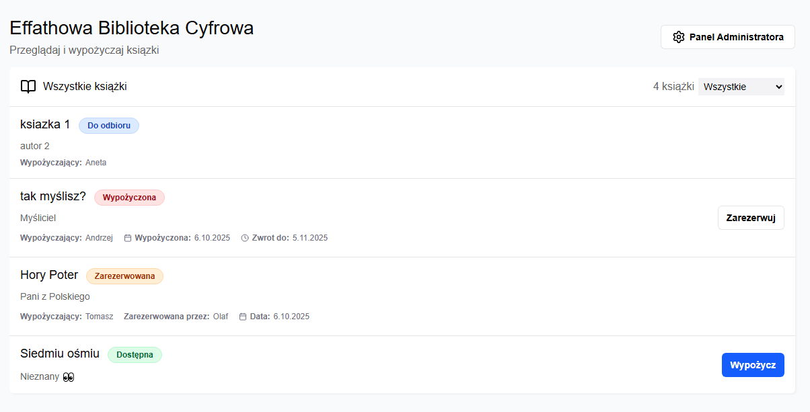
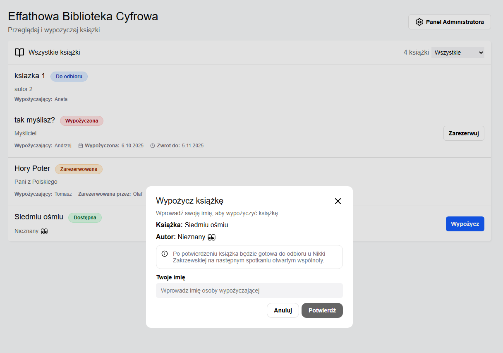
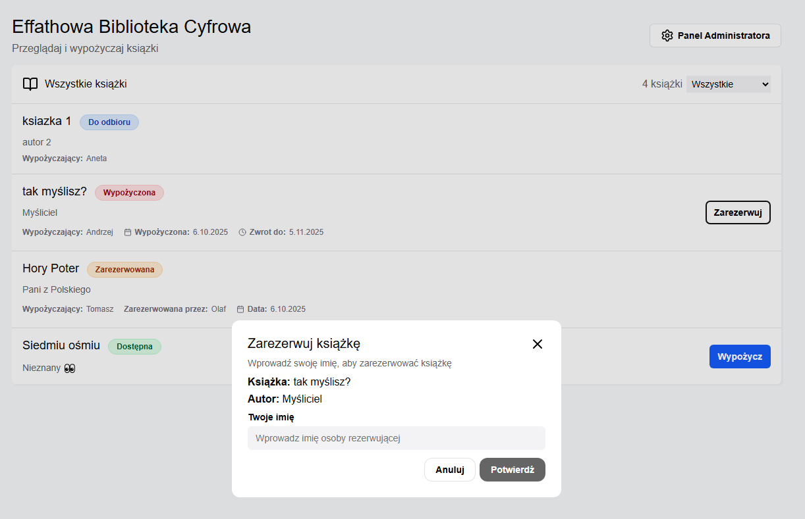
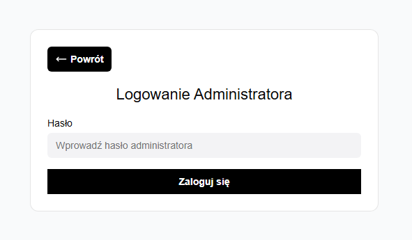
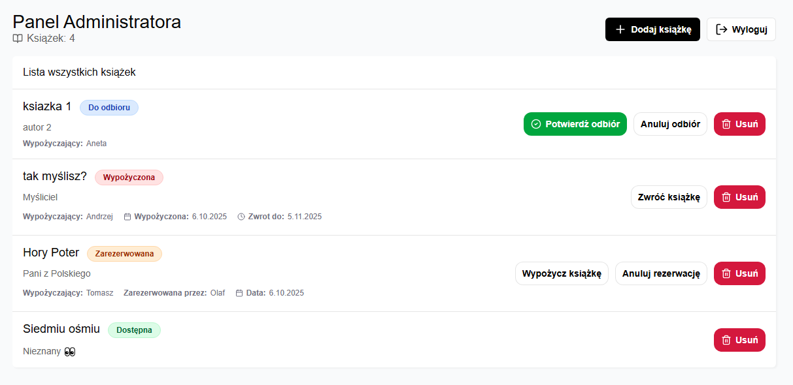
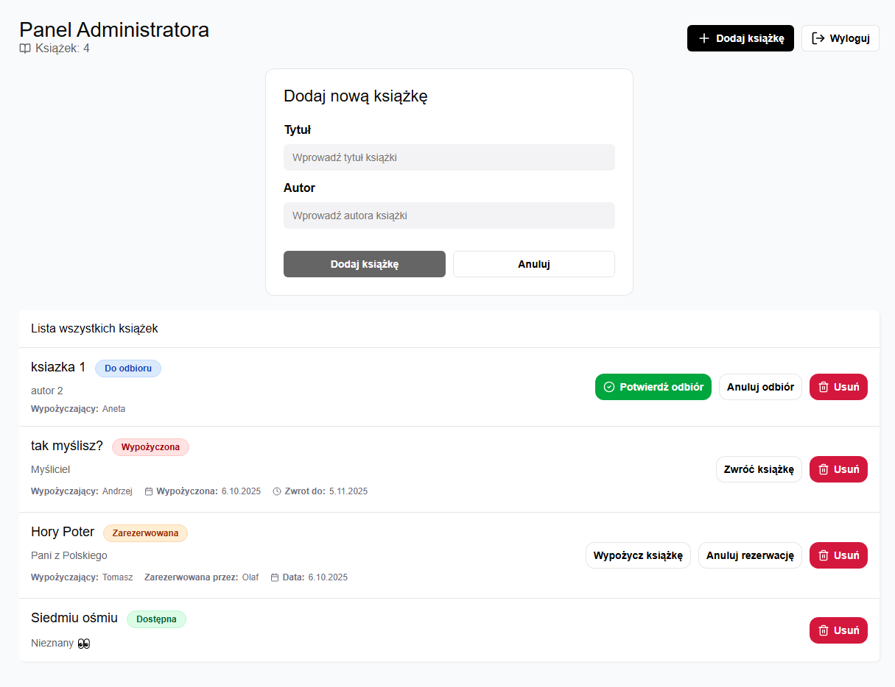

<h1>Effatha Digital Library</h1>

  

  
  
  
  
  
  

A web app for the **Effatha community in Gliwice** to manage its shared book collection. Members browse the catalogue, borrow and reserve books, and an admin manages the collection from a separate panel.

It was my first time building something that felt like a real application end to end. A colleague had vibe-coded a rough prototype and asked me to improve it, so I shipped a working version in a single evening: no polished design or big product plan, just focus on getting it working.

## Features

**For members**
- Book list with live statuses: **available**, **reserved** or **borrowed**
- Filtering books by status
- Borrowing and reserving a book from a modal, with the borrower's name and a return date

**For the admin**
- Separate, password-protected admin panel
- Adding new books (title, author) and removing them
- Handling the whole loan flow: confirming a pickup, marking a book as returned and cancelling reservations

<table>
  <tr>
    <td></td>
    <td></td>
  </tr>
  <tr>
    <td align="center">Borrowing a book</td>
    <td align="center">Reserving a book</td>
  </tr>
  <tr>
    <td></td>
    <td></td>
  </tr>
  <tr>
    <td align="center">Admin login</td>
    <td align="center">Admin panel</td>
  </tr>
</table>

## Tech stack

React 19 · TypeScript · Vite · Supabase (database + auth) · TanStack Query · React Router · Lucide icons · Netlify

## What I learned

- **Business logic is the hard part.** Reservation states, the transitions between them and lots of edge cases ("if it's reserved like this, what happens next?") took more thought than the UI.
- **Supabase + TanStack Query** were new to me. This was my first serious use of both, including designing a simple database schema for books.
- **Auth needs a clear security model.** Access to the main view is password-based and backed by a database account, but some admin authorisation is handled on the client. Today I'd design this differently.

## What's next

I'm planning to rebuild the app in **Next.js** (and maybe as a mobile app), with much better UX, visual design and proper planning from the start.

## Demo access

You can try the [live demo](https://biblioteka.effathagliwice.pl/) with these test accounts:

| Role | URL | Login |
| --- | --- | --- |
| Member | `/user-login` | password: `demo_user_202#` |
| Admin | `/login` | email: `demo@example.com`, password: `demo_admin_202#` |

## Running locally

1. Install dependencies: `npm install`
2. Copy `.env.example` to `.env`
3. Fill in the variables in `.env`:
   - `VITE_SUPABASE_URL` and `VITE_SUPABASE_KEY`: Supabase Dashboard → **Settings → API**
   - `VITE_SUPABASE_EMAIL`: email of the admin account in Supabase Auth (Authentication → Users)
   - `VITE_USER_PASSWORD`: the password members use to log in (you choose it)
4. Start the dev server: `npm run dev`

---

More of my projects → <a href="https://maxtkaczyk.pl"><b>maxtkaczyk.pl</b></a>
